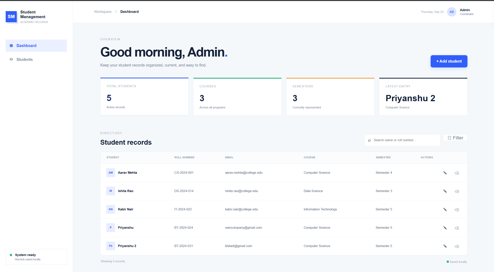
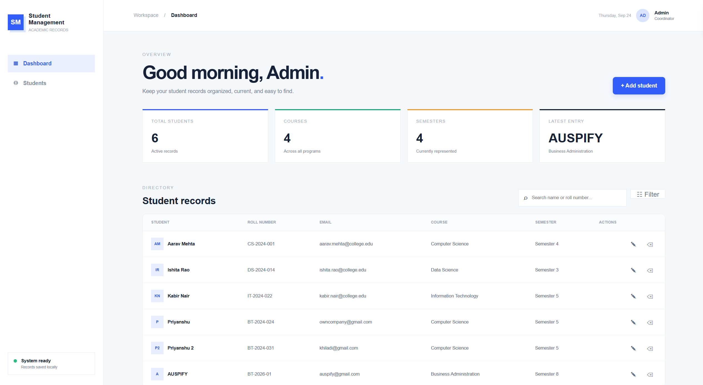
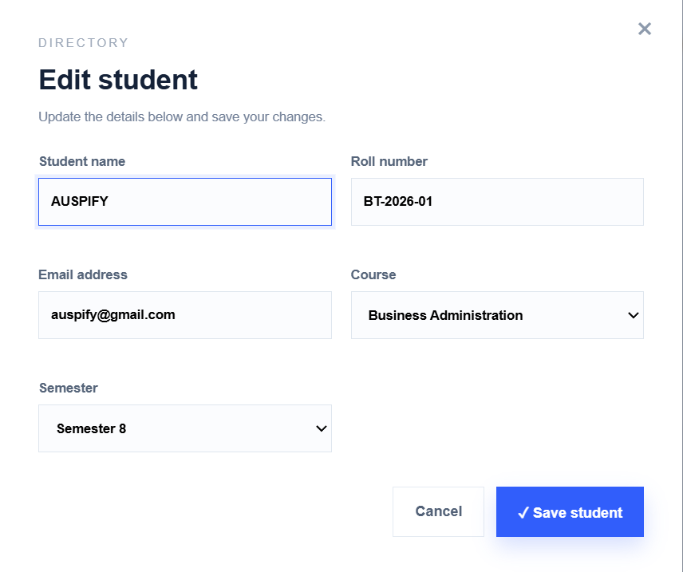
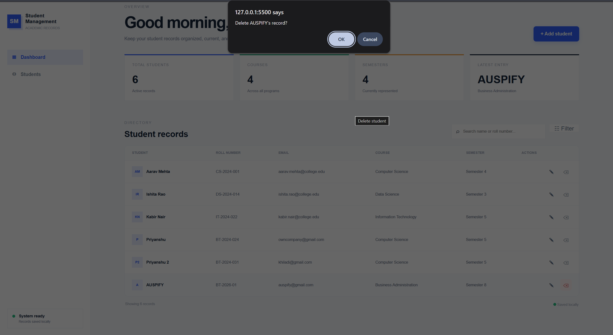
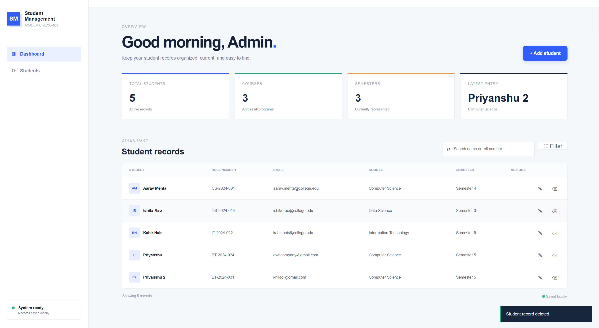
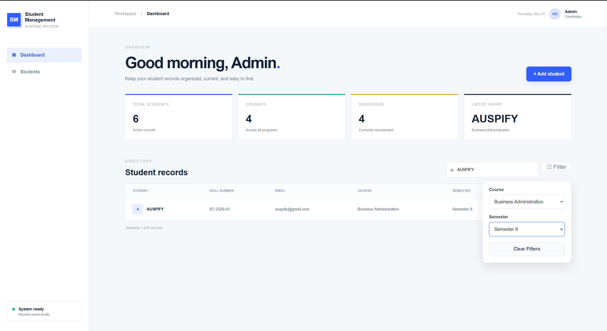

# Student Management System

A simple and responsive Student Management System for managing student academic records. Built as Task 1 of the Auspify Software Development Internship.

## Live Demo

[View Live Student Management System](https://priyanshuattri657.github.io/student-management-system/)

## Features

- Add new student records
- Edit existing student records
- Delete student records
- Search students by name or roll number
- Filter students by course and semester
- Display total students, courses, and semesters
- Store records locally using browser LocalStorage
- Responsive dashboard interface
- Form validation
- Delete confirmation
- Success and error notifications

## Technologies Used

- HTML5
- CSS3
- JavaScript
- LocalStorage

## Project Structure

```text
student-management-system/
│
├── index.html
├── style.css
├── script.js
│
├── dashboard.png
├── add-student.png
├── edit-student.png
├── delete-alert.png
├── search.png
├── student-added.png
└── student-delete.png
```

## Screenshots

### Dashboard


### Add Student


### Student Added


### Edit Student


### Delete Confirmation


### Student Deleted


### Search


## Setup

1. Clone the repository
```
   git clone https://github.com/priyanshuattri657/student-management-system.git
```
2. Open `index.html` in your browser.

## Author

**Priyanshu Attri**
GitHub: [priyanshuattri657](https://github.com/priyanshuattri657) · LinkedIn: [priyanshuattri](https://linkedin.com/in/priyanshuattri)

#Auspify #AuspifyTechnologies #AuspifyInternship #AuspifyProjects
